# 基于微信小程序的自习室预约系统

> 🎓 **计算机毕业设计 · 基于微信小程序的自习室预约系统**
>
> 本仓库只放**项目介绍 + 运行截图**（截图是站点带水印的原图，存在仓库 `images/` 里）。
>
> 👉 **完整可运行源码 / 数据库脚本 / 部署文档：[点我获取](https://geekcode.top/archives/%E5%9F%BA%E4%BA%8E%E5%BE%AE%E4%BF%A1%E5%B0%8F%E7%A8%8B%E5%BA%8F%E7%9A%84%E8%87%AA%E4%B9%A0%E5%AE%A4%E9%A2%84%E7%BA%A6%E7%B3%BB%E7%BB%9F?utm_source=github)**
>
> 💬 咨询微信：**ir9372**　|　🌐 更多项目：[极客代码 geekcode.top](https://geekcode.top/?utm_source=github)
>
> 📌 项目详情页：<https://geekcode.top/archives/%E5%9F%BA%E4%BA%8E%E5%BE%AE%E4%BF%A1%E5%B0%8F%E7%A8%8B%E5%BA%8F%E7%9A%84%E8%87%AA%E4%B9%A0%E5%AE%A4%E9%A2%84%E7%BA%A6%E7%B3%BB%E7%BB%9F?utm_source=github>

<table><td width="230" align="center"> <b>扫码加微信 ir9372</b></td><td valign="middle">📦 源码 = 项目介绍 + 全部运行截图 + 数据库 + 部署文档 👉 点上方任意截图，直接跳到 <b>极客代码 geekcode.top</b> 详情页</td></table>

---

<h1>基于微信小程序的自习室预约系统</h1>
<h2>项目概述</h2>

本项目旨在开发一套基于微信小程序的自习室预约系统，以解决高校或公共学习场所自习资源分配不均、预约流程繁琐及现场管理效率低下的问题。系统采用前后端分离架构，前端依托微信小程序提供轻量级用户入口，后端基于 Java Spring Boot 框架构建 RESTful API，数据库层使用 MySQL 并结合 MyBatis-Plus 进行持久化操作。核心功能涵盖自习室信息管理、在线预约、学习状态记录（结束学习）、公告资讯发布及意见反馈机制。适用人群主要为需要预约自习座位的学生或公众用户，以及负责资源调度与内容管理的后台管理员。通过数字化手段实现自习资源的透明化展示与高效流转，提升用户体验与管理效能。

<h2>技术架构</h2>
<h3>1. 总体架构</h3>

系统采用经典的 B/S 架构模式，分为客户端（微信小程序）、服务端（Spring Boot）和数据存储层（MySQL）。整体遵循 MVC 设计模式，确保业务逻辑、数据访问与界面展示的解耦。

<a href="https://geekcode.top/archives/%E5%9F%BA%E4%BA%8E%E5%BE%AE%E4%BF%A1%E5%B0%8F%E7%A8%8B%E5%BA%8F%E7%9A%84%E8%87%AA%E4%B9%A0%E5%AE%A4%E9%A2%84%E7%BA%A6%E7%B3%BB%E7%BB%9F?utm_source=github" title="查看完整源码">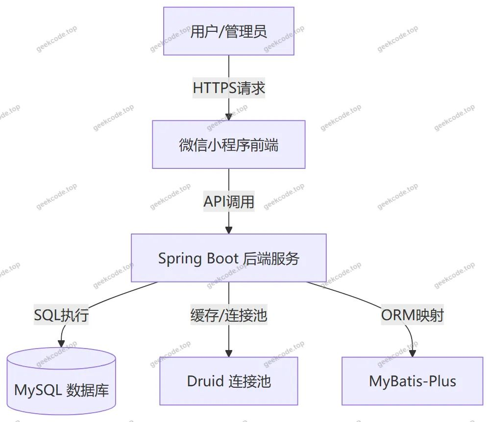</a>

<h3>2. 核心技术选型</h3>
<ul>
<li><strong>后端框架</strong>：采用 Spring Boot 作为基础框架，利用其自动配置特性简化部署流程。依赖包括 <code>spring-core</code>, <code>spring-context</code>, <code>spring-webmvc</code> 等，构建稳健的服务层。</li>
<li><strong>持久层框架</strong>：使用 MyBatis-Plus 增强传统 MyBatis 的功能，提供通用的 CRUD 接口，减少样板代码，提高开发效率。</li>
<li><strong>数据库连接池</strong>：选用 Alibaba Druid 作为数据库连接池，具备强大的监控功能和高效的性能表现，保障高并发下的数据访问稳定性。</li>
<li><strong>前端技术</strong>：前台采用 Vue.js 集成方案（vue-integrated），结合微信小程序原生能力，实现跨平台兼容的用户交互界面。</li>
</ul>
<h3>3. 数据库设计要点</h3>

数据库主要围绕“用户”、“自习室”、“预约记录”、“学习结束记录”、“公告”、“反馈”及“系统配置”七大实体建立表结构。各表之间通过外键关联，例如预约表需关联用户 ID 和自习室 ID，以确保数据的完整性与一致性。

<h2>功能模块</h2>

根据提供的路由配置及截图功能列表，系统功能划分为小程序用户端和管理后台两部分。

<h3>1. 小程序用户端（前台）</h3>

用户通过微信小程序登录注册后，可访问以下功能页面：

<ul>
<li><strong>首页与导航</strong>：展示系统概览，包含公告资讯入口及个人中心入口。</li>
<li><strong>用户认证模块</strong>：</li>
<li><strong>登录/注册</strong>：支持新用户账号注册及老用户身份验证。</li>
<li><strong>忘记密码</strong>：提供密码找回通道。</li>
<li><strong>个人信息管理</strong>：查看和修改个人基本资料。</li>
<li><strong>自习室服务模块</strong>：</li>
<li><strong>自习室浏览</strong>：查看自习室列表及具体详情信息。</li>
<li><strong>自习室预约</strong>：发起预约申请，查看预约列表及单个预约的详细信息。</li>
<li><strong>结束学习</strong>：提交学习结束记录，查看历史结束学习列表及详情。</li>
<li><strong>资讯与互动模块</strong>：</li>
<li><strong>公告资讯</strong>：阅读系统发布的最新通知与新闻。</li>
<li><strong>意见反馈</strong>：提交对系统的建议或投诉，并查看反馈处理进度及详情。</li>
</ul>
<h3>2. 管理后台（Admin）</h3>

管理员通过 Web 端登录后台，拥有全局数据管理与配置权限：

<ul>
<li><strong>系统管理</strong>：</li>
<li><strong>配置文件 (<code>/config</code>)</strong>：管理系统基础参数设置。</li>
<li><strong>登录页</strong>：管理员身份认证入口。</li>
<li><strong>业务数据管理</strong>：</li>
<li><strong>用户管理 (<code>/yonghu</code>)</strong>：查看、编辑或删除注册用户信息。</li>
<li><strong>自习室管理 (<code>/zixishi</code>)</strong>：维护自习室的基本信息（如名称、容量、位置等）。</li>
<li><strong>自习室预约管理 (<code>/zixishiyuyue</code>)</strong>：审核、查询及管理所有用户的预约记录。</li>
<li><strong>结束学习管理 (<code>/jieshuxuexi</code>)</strong>：查看用户提交的学习结束记录。</li>
<li><strong>内容与反馈管理</strong>：</li>
<li><strong>公告资讯管理 (<code>/news</code>)</strong>：发布、编辑或删除系统公告。</li>
<li><strong>意见反馈管理 (<code>/yijianfankui</code>)</strong>：接收并回复用户提交的反馈意见。</li>
</ul>
<h2>用户角色与权限</h2>

系统主要包含两种角色：<strong>普通用户</strong>（学生/访客）和<strong>管理员</strong>。

<table>
<thead>
<tr>
<th align="left">角色</th>
<th align="left">权限范围</th>
<th align="left">可访问功能模块</th>
</tr>
</thead>
<tbody><tr>
<td align="left"><strong>普通用户</strong></td>
<td align="left">仅限个人数据操作及公共资源浏览</td>
<td align="left">1. <strong>个人中心</strong>：注册、登录、找回密码、修改个人信息。2. <strong>自习室服务</strong>：浏览自习室详情、创建预约、查看自己的预约列表、提交结束学习记录。3. <strong>资讯互动</strong>：阅读公告资讯、提交意见反馈、查看自己的反馈记录。</td>
</tr>
<tr>
<td align="left"><strong>管理员</strong></td>
<td align="left">全量数据读写及系统配置权限</td>
<td align="left">1. <strong>用户管理</strong>：查看所有用户信息，执行增删改查操作。2. <strong>自习室管理</strong>：维护自习室基础数据，控制开放状态。3. <strong>预约管理</strong>：查看所有预约记录，进行审核或异常处理。4. <strong>学习记录管理</strong>：监控所有结束学习的数据流水。5. <strong>内容管理</strong>：发布和管理公告资讯。6. <strong>反馈处理</strong>：查阅所有用户反馈并进行回复或关闭。7. <strong>系统配置</strong>：修改系统全局参数。</td>
</tr>
</tbody></table>

<em>注：根据现有源码 Controller 列表，未明确区分教师或特定子角色，仅存在通用用户与管理员的二元权限结构。</em>

<h2>项目特色与创新点</h2>
<ol>
<li><strong>移动端优先体验</strong>：基于微信小程序生态，无需安装独立 App，实现了“即用即走”的轻量化体验，降低了用户的使用门槛，特别适合校园场景下的高频短时访问需求。</li>
<li><strong>全流程闭环管理</strong>：从自习室资源展示、在线预约、实际学习打卡到结束学习记录，形成了完整的数据闭环。不仅解决了“约座难”的问题，还通过“结束学习”功能强化了资源占用的时效性管理，防止恶意占座。</li>
<li><strong>实时互动与反馈机制</strong>：内置公告资讯与意见反馈模块，使得管理方能够及时发布场地变动信息，同时为用户提供直接沟通渠道，提升了系统的服务响应速度和用户满意度。</li>
<li><strong>高效的后端架构</strong>：采用 Spring Boot + MyBatis-Plus + Druid 的组合，在保证开发效率的同时，提供了良好的数据库连接管理和 SQL 执行优化能力，能够支撑一定规模的并发预约请求。</li>
</ol>
<h2>部署环境</h2>

为确保系统正常运行，需准备以下软硬件环境：

<ul>
<li><strong>操作系统</strong>：Windows 10/11, macOS, 或 Linux (CentOS/Ubuntu)</li>
<li><strong>Java 运行环境</strong>：JDK 1.8 或以上版本</li>
<li><strong>数据库</strong>：MySQL 5.7 或 8.0 版本</li>
<li><strong>构建工具</strong>：Maven 3.6+ (用于后端依赖管理)</li>
<li><strong>前端开发工具</strong>：微信开发者工具 (WeChat DevTools)，Node.js (用于 Vue 集成部分的环境依赖)</li>
<li><strong>浏览器</strong>：Chrome, Edge 等现代浏览器 (用于访问管理后台)</li>
</ul>

<strong>部署步骤简述</strong>：

<ol>
<li>初始化 MySQL 数据库，导入项目所需的 SQL 脚本。</li>
<li>配置后端 <code>application.yml</code> 文件中的数据库连接信息及端口。</li>
<li>编译并启动 Spring Boot 后端服务。</li>
<li>在微信开发者工具中导入小程序源代码，配置合法的服务器域名（指向后端 API 地址）。</li>
<li>在浏览器中访问管理后台地址，使用默认管理员账号登录进行数据初始化。</li>
</ol>
<h2>五、技术特性</h2>
<ul>
<li>前后端集成部署，前端资源打包至后端 static 目录</li>
<li>使用 MyBatis-Plus 简化数据访问层开发</li>
</ul>
<h2>六、功能模块截图</h2>
<h3>前台用户端</h3>
<h4>前台首页框架</h4>

<h3>微信小程序用户端</h3>

<figure><figcaption>小程序-登录</figcaption></figure>
<figure><figcaption>小程序-个人信息</figcaption></figure>
<figure><figcaption>小程序-公告资讯</figcaption></figure>
<figure><figcaption>小程序-结束学习列表</figcaption></figure>
<figure><a href="https://geekcode.top/archives/%E5%9F%BA%E4%BA%8E%E5%BE%AE%E4%BF%A1%E5%B0%8F%E7%A8%8B%E5%BA%8F%E7%9A%84%E8%87%AA%E4%B9%A0%E5%AE%A4%E9%A2%84%E7%BA%A6%E7%B3%BB%E7%BB%9F?utm_source=github" title="查看完整源码">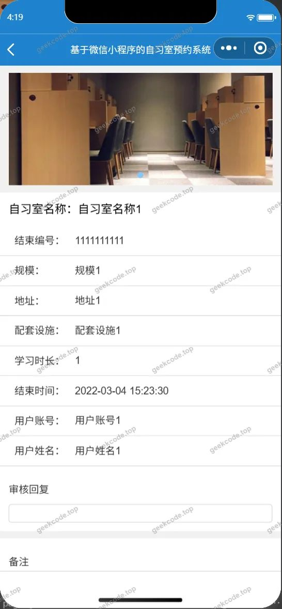</a><figcaption>小程序-结束学习详情</figcaption></figure>
<figure><a href="https://geekcode.top/archives/%E5%9F%BA%E4%BA%8E%E5%BE%AE%E4%BF%A1%E5%B0%8F%E7%A8%8B%E5%BA%8F%E7%9A%84%E8%87%AA%E4%B9%A0%E5%AE%A4%E9%A2%84%E7%BA%A6%E7%B3%BB%E7%BB%9F?utm_source=github" title="查看完整源码">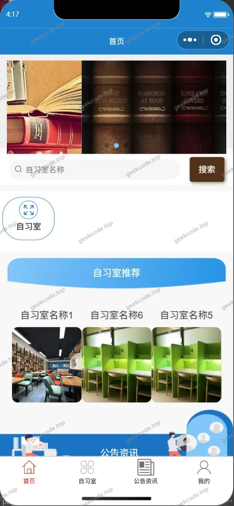</a><figcaption>小程序-首页</figcaption></figure>
<figure><figcaption>小程序-忘记密码</figcaption></figure>
<figure><figcaption>小程序-我的</figcaption></figure>
<figure><figcaption>小程序-意见反馈列表</figcaption></figure>
<figure><figcaption>小程序-意见反馈详情</figcaption></figure>
<figure><a href="https://geekcode.top/archives/%E5%9F%BA%E4%BA%8E%E5%BE%AE%E4%BF%A1%E5%B0%8F%E7%A8%8B%E5%BA%8F%E7%9A%84%E8%87%AA%E4%B9%A0%E5%AE%A4%E9%A2%84%E7%BA%A6%E7%B3%BB%E7%BB%9F?utm_source=github" title="查看完整源码">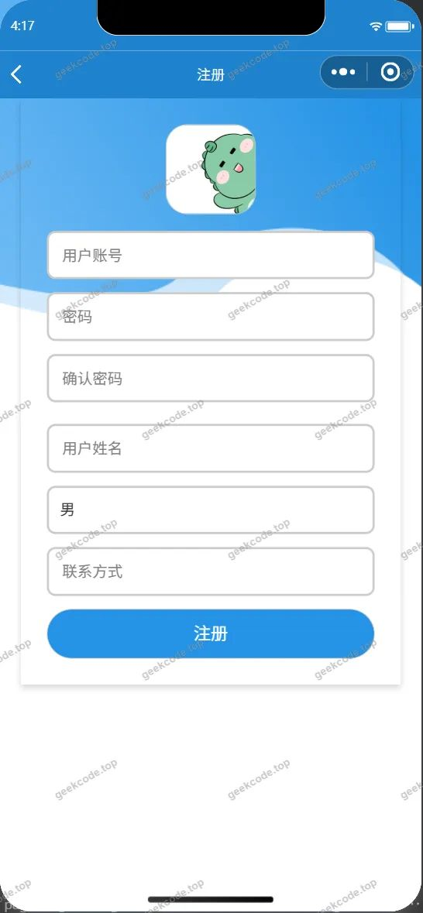</a><figcaption>小程序-注册</figcaption></figure>
<figure><a href="https://geekcode.top/archives/%E5%9F%BA%E4%BA%8E%E5%BE%AE%E4%BF%A1%E5%B0%8F%E7%A8%8B%E5%BA%8F%E7%9A%84%E8%87%AA%E4%B9%A0%E5%AE%A4%E9%A2%84%E7%BA%A6%E7%B3%BB%E7%BB%9F?utm_source=github" title="查看完整源码">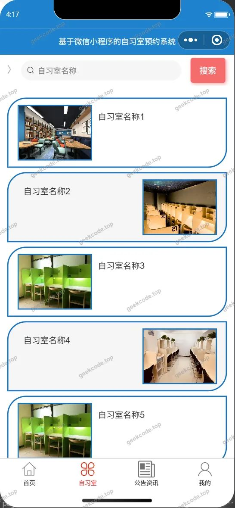</a><figcaption>小程序-自习室</figcaption></figure>
<figure><figcaption>小程序-自习室详情</figcaption></figure>
<figure><figcaption>小程序-自习室预约列表</figcaption></figure>
<figure><figcaption>小程序-自习室预约详情</figcaption></figure>

<h3>微信小程序管理端</h3>

<figure><figcaption>小程序-管理端-用户列表</figcaption></figure>
<figure><figcaption>小程序-管理端-用户详情</figcaption></figure>

<h3>后台管理端</h3>
<h4>后台-登录页</h4>

<h4>后台-公告资讯</h4>

<a href="https://geekcode.top/archives/%E5%9F%BA%E4%BA%8E%E5%BE%AE%E4%BF%A1%E5%B0%8F%E7%A8%8B%E5%BA%8F%E7%9A%84%E8%87%AA%E4%B9%A0%E5%AE%A4%E9%A2%84%E7%BA%A6%E7%B3%BB%E7%BB%9F?utm_source=github" title="查看完整源码">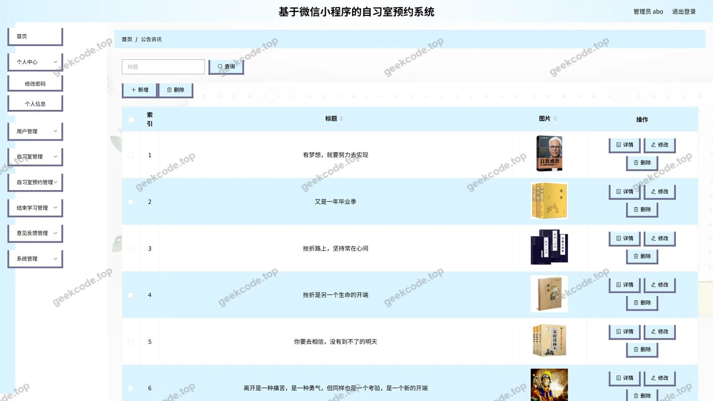</a>

<h4>后台-结束学习</h4>

<a href="https://geekcode.top/archives/%E5%9F%BA%E4%BA%8E%E5%BE%AE%E4%BF%A1%E5%B0%8F%E7%A8%8B%E5%BA%8F%E7%9A%84%E8%87%AA%E4%B9%A0%E5%AE%A4%E9%A2%84%E7%BA%A6%E7%B3%BB%E7%BB%9F?utm_source=github" title="查看完整源码">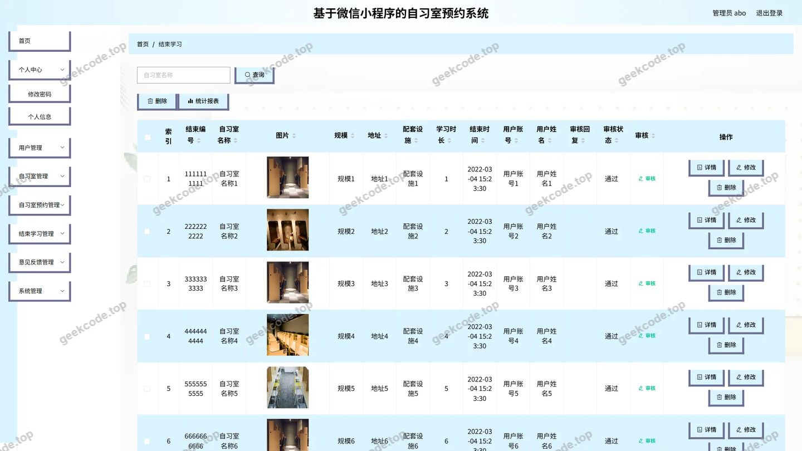</a>

<h4>后台-配置文件</h4>

<a href="https://geekcode.top/archives/%E5%9F%BA%E4%BA%8E%E5%BE%AE%E4%BF%A1%E5%B0%8F%E7%A8%8B%E5%BA%8F%E7%9A%84%E8%87%AA%E4%B9%A0%E5%AE%A4%E9%A2%84%E7%BA%A6%E7%B3%BB%E7%BB%9F?utm_source=github" title="查看完整源码">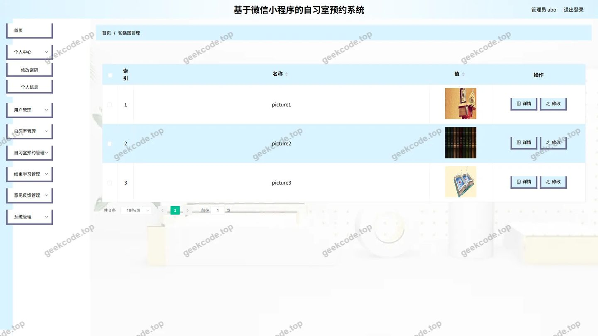</a>

<h4>后台首页</h4>

<h4>后台-用户</h4>

<a href="https://geekcode.top/archives/%E5%9F%BA%E4%BA%8E%E5%BE%AE%E4%BF%A1%E5%B0%8F%E7%A8%8B%E5%BA%8F%E7%9A%84%E8%87%AA%E4%B9%A0%E5%AE%A4%E9%A2%84%E7%BA%A6%E7%B3%BB%E7%BB%9F?utm_source=github" title="查看完整源码">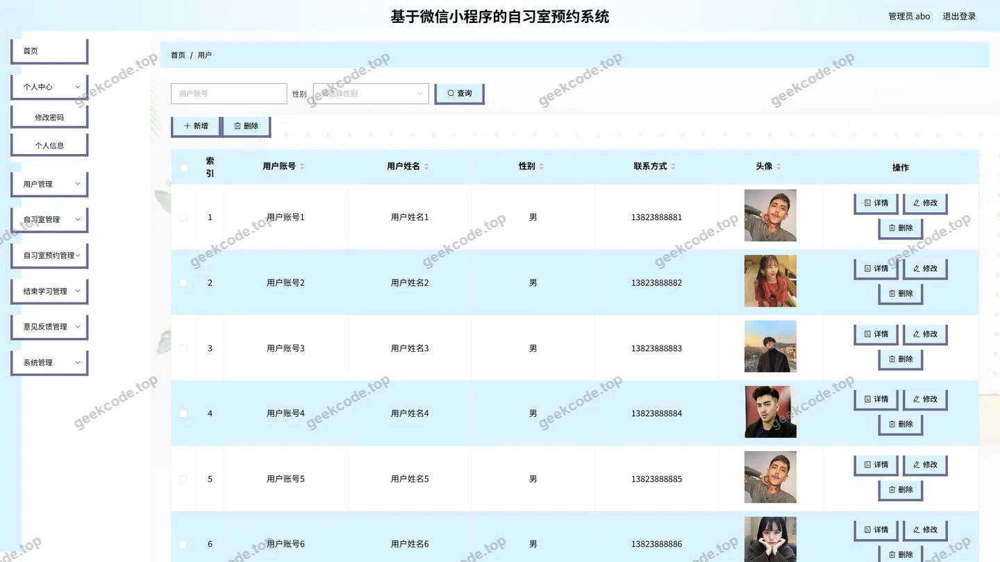</a>

<h4>后台-自习室</h4>

<a href="https://geekcode.top/archives/%E5%9F%BA%E4%BA%8E%E5%BE%AE%E4%BF%A1%E5%B0%8F%E7%A8%8B%E5%BA%8F%E7%9A%84%E8%87%AA%E4%B9%A0%E5%AE%A4%E9%A2%84%E7%BA%A6%E7%B3%BB%E7%BB%9F?utm_source=github" title="查看完整源码">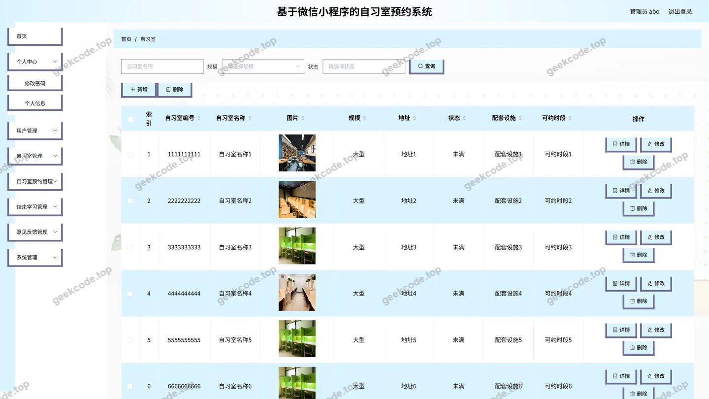</a>

<h4>后台-自习室预约</h4>

<a href="https://geekcode.top/archives/%E5%9F%BA%E4%BA%8E%E5%BE%AE%E4%BF%A1%E5%B0%8F%E7%A8%8B%E5%BA%8F%E7%9A%84%E8%87%AA%E4%B9%A0%E5%AE%A4%E9%A2%84%E7%BA%A6%E7%B3%BB%E7%BB%9F?utm_source=github" title="查看完整源码">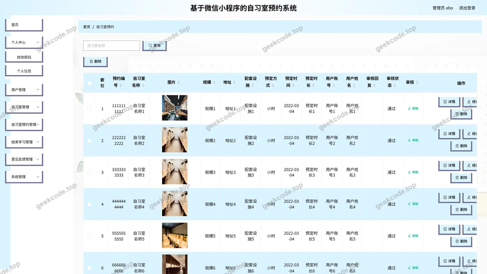</a>

---

## 获取完整源码

| 项目 | 说明 |
| --- | --- |
| 项目名 | 基于微信小程序的自习室预约系统 |
| 运行截图 | 本文 27 张（站点带水印原图，仓库 `images/` 目录） |
| 完整源码 | [https://geekcode.top/archives/%E5%9F%BA%E4%BA%8E%E5%BE%AE%E4%BF%A1%E5%B0%8F%E7%A8%8B%E5%BA%8F%E7%9A%84%E8%87%AA%E4%B9%A0%E5%AE%A4%E9%A2%84%E7%BA%A6%E7%B3%BB%E7%BB%9F?utm_source=github](https://geekcode.top/archives/%E5%9F%BA%E4%BA%8E%E5%BE%AE%E4%BF%A1%E5%B0%8F%E7%A8%8B%E5%BA%8F%E7%9A%84%E8%87%AA%E4%B9%A0%E5%AE%A4%E9%A2%84%E7%BA%A6%E7%B3%BB%E7%BB%9F?utm_source=github) |
| 咨询微信 | **ir9372**（备注：jingpin-yuanma） |
| 更多项目 | [极客代码 geekcode.top](https://geekcode.top/?utm_source=github) |

> 需要源码、部署、改配置、跑不起来等问题，加微信 ir9372 沟通，说明项目名即可。
